# EnergyWatch

A personal Python/Streamlit prototype for hourly energy forecasting, calibrated residual alerts, and version-bound human alert annotations. No API key, cloud service or LLM is required: the learned model is ridge regression.

## Run

Python 3.11+, Windows PowerShell:

```powershell
python -m venv .venv
.\.venv\Scripts\python.exe -m pip install -r requirements.txt
.\.venv\Scripts\python.exe -X utf8 -m unittest discover -s tests -v
.\.venv\Scripts\python.exe -X utf8 evaluate.py --output reports/my-evaluation-v1.json
.\.venv\Scripts\python.exe -m streamlit run app.py --server.address 127.0.0.1 --server.port 8515
```

Open http://127.0.0.1:8515. [Vietnamese walkthrough](HUONG_DAN.md) · [Validation scope](VALIDATION.md) · [Case study](CASE_STUDY.md).

## Workflow

```mermaid
flowchart LR
  A[Hourly kWh CSV] --> B[Validate continuous shared time grid]
  B --> C[Chronological train / validation / calibration / test]
  C --> D[Train-only scaling and per-meter ridge fits]
  D --> E[Validation selects alpha]
  E --> F[Calibration sets per-meter residual thresholds]
  F --> G[One-hour-ahead test backtest]
  G --> H[Contiguous alert events]
  H --> I[Human notes and ZIP report]
```



### Data contract

Exactly `timestamp,meter_id,kwh` in that order, UTF-8 CSV. Time is `YYYY-MM-DDTHH:00`, fixed UTC+07:00. kWh means energy used during that hour, not cumulative meter readings, power in kW, or monetary cost.

The demo requires 84–365 complete days, at most 10 meters, the same uninterrupted hourly grid per meter, and an 8 MB input limit. IDs use letters/digits/underscore. NaN, infinity, negative values, duplicates, missing hours and unsorted within-meter timestamps are rejected. There is no automatic gap filling, timezone inference, daylight-saving handling or unit conversion.

### Forecast and alert method

- The first 50% of hours is train; the next approximately 1/6 is validation; the next 1/6 is calibration; the remainder is test. In the 180-day demo: 90/30/30/30 days.
- Features use target-hour calendar information and observed lags: 24 hours, 168 hours, trailing 24-hour mean, and a linear time index. No target-hour kWh or anomaly labels are features.
- Standardization and ridge coefficients are fitted on train only, separately per meter. A shared alpha from 0.1/10/100 is selected by pooled validation MAE. The model is not refitted on validation/calibration/test.
- The per-meter absolute calibration error cutoff uses rank `min(n, ceil((n+1)*(1-alpha)))`, with alpha 0.005. Absolute test residuals strictly exceeding the cutoff become alerts; consecutive flagged hours per meter form events.
- The test is a rolling one-hour-ahead backtest: earlier observed test values can enter later lag features. This is not a whole-test forecast from a single origin or a multi-hour recursive forecast.
- Lag-24h and lag-168h baselines use the same test targets. A separate estimate is provided for the one hour after the dataset ends; no future observation is available to validate it.

The linear solve uses [NumPy's linear algebra solver](https://numpy.org/doc/stable/reference/generated/numpy.linalg.solve.html). Calibration bands are empirical; temporal dependence, drift and contaminated lag features prevent a guaranteed future-coverage claim. A residual alert is not a verified equipment fault or causal diagnosis.

### Synthetic demo and measured results

The bundled CSV contains three fictional meters over 180 days, with daily/weekly patterns, a gradual trend, noise and 24 injected abnormal test hours. Labels are stored separately in `data/truth.json`, bound to the exact CSV SHA-256. The pipeline does not read labels; evaluation reads them after prediction.

Local demo result: selected `ridge_0.1`; test MAE about 1.2273 kWh versus 1.8816 for lag-168h and 3.9454 for lag-24h, over 2,160 meter-hours. Hour-level detection: TP=24, FP=11, FN=0, TN=2,125, precision 68.57%, recall 100%, normal false-alarm rate 0.515%. There are 35 flagged hours grouped into 20 alert events. These are synthetic results, not real-world forecasting or fault-detection accuracy.

### Review and export

SQLite stores run fingerprints, test predictions, fitted parameters, events and reviewer notes. States are `investigate`, `expected_variation` and `data_issue`; these are reviewer opinions, not verified causes. Note revisions prevent stale overwrites. Input/model-output changes create a new run without inheriting old notes; rerunning the same result preserves notes.

Reports deliberately permit partial review. ZIP files contain `run-and-review.json`, `all-alert-events.csv`, and `test-predictions.csv`. Unreviewed events remain visible as `pending`, with explicit reviewed/pending counts. Notes do not update the model or ground-truth metrics automatically.

## Limits and local data

This is retrospective file analysis, not streaming meter monitoring, device control, cost optimization or a deployed energy-management service. No measured energy savings, causal fault identification or guaranteed prediction interval coverage is claimed.

Only use synthetic or authorized data. The app stores processed series/predictions and notes unencrypted in `private/energywatch.sqlite3`; reviewer labels are not authentication and history is not immutable. Raw uploads/results can also remain in local Streamlit session/cache memory. There is no network request in the application workflow. Publication instructions are kept outside the repository.
